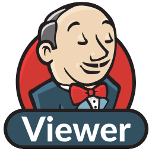
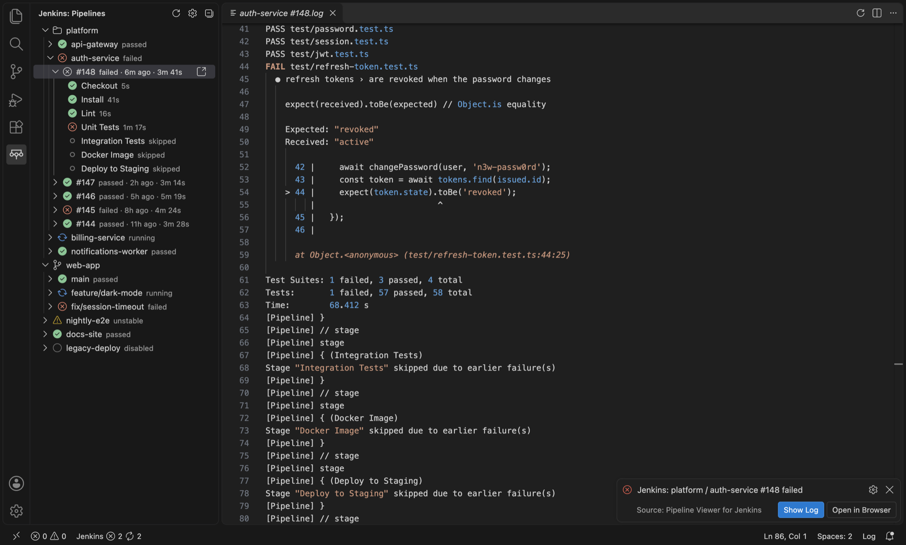

<p align="center">
  
</p>

# Pipeline Viewer for Jenkins

Browse Jenkins® jobs, builds, pipeline stages and console logs from the VS Code sidebar.



## Features

- **Pipelines view** in the activity bar: folders and multibranch projects → jobs → recent builds → pipeline stages, each with a live status icon.
- **Status bar summary** with the number of failing and running jobs. Click it to open the view.
- **Notifications** when a build finishes (failures only by default).
- **Console logs** open in an editor tab, scrolled to the end. Use the refresh button in the editor title to reload a running build's log.
- **Actions** on jobs and builds: Build Now, Abort Build, Open in Browser.
- **AI agent access** through a local MCP server, so agents such as Claude Code can check builds and read logs for you.

## Installation

Install from the [Visual Studio Marketplace](https://marketplace.visualstudio.com/items?itemName=nihatcanco.pipeline-viewer-for-jenkins), or search for **Pipeline Viewer for Jenkins** in the VS Code Extensions view.

## Getting started

1. Create an API token in Jenkins: click your user name → **Security** → **API Token** → **Add new Token**.
2. In VS Code, run **Jenkins: Configure Connection** from the Command Palette and enter the server URL, your username and the token.

Leave the username empty to connect anonymously, if your Jenkins allows read access without logging in.

## Using it from AI agents

The extension can run a local [MCP](https://modelcontextprotocol.io) server, so AI agents such as Claude Code, Cursor or GitHub Copilot can look at Jenkins for you. They can list jobs, check builds and stages, and read console logs to find out why a build failed. They can also ask to start or abort a build, which you approve in VS Code each time.

1. Open the settings page and turn on **Allow AI agents to use Jenkins** under **AI Agent Access (MCP)**, or run **Jenkins: Set Up AI Agent Access (MCP)** from the Command Palette and choose **Turn On**.
2. Copy the setup for your agent:
   - **Claude Code:** a `claude mcp add …` command. Run it in a terminal.
   - **Other MCP clients:** a JSON entry for the client's MCP configuration file.

The copied setup contains an access token, so keep it out of repositories. The settings page also shows whether the server is running, changes its port, resets the access token and explains how agent access works.

| Tool | What it does |
| --- | --- |
| `list_jobs` | Jobs with their status and last completed build, folders expanded |
| `get_builds` | Recent builds of a job |
| `get_build` | Status and timing of one build, with its pipeline stages |
| `get_job_parameters` | Build parameters a job declares |
| `get_console_log` | A page of a build's console output, the end by default |
| `start_build` | Starts a build, with parameters, after you approve it |
| `abort_build` | Aborts a running build after you approve it |

The server runs while VS Code is open. With several windows open, one of them serves agents and shows the approvals. With remote development (SSH, WSL or containers), the server runs on the remote machine, so run the agent there as well.

## Settings

Open the settings page with the gear button in the Pipelines view title, or with **Jenkins: Open Settings** from the Command Palette. It edits the connection (including the API token), the preferences and AI agent access below. They are regular VS Code settings, so they can also be changed in the Settings editor or `settings.json`.

| Setting | Default | Description |
| --- | --- | --- |
| `pipelineViewerForJenkins.url` | | Base URL of the Jenkins server (user settings only) |
| `pipelineViewerForJenkins.username` | | Jenkins username (user settings only) |
| `pipelineViewerForJenkins.refreshInterval` | `30` | Polling interval in seconds (5 to 86400) |
| `pipelineViewerForJenkins.buildHistoryLimit` | `10` | Builds listed under each job (1 to 100) |
| `pipelineViewerForJenkins.notifications` | `failures` | `failures`, `all` or `off` |
| `pipelineViewerForJenkins.mcp.enabled` | `false` | Run the MCP server for AI agents (user settings only) |
| `pipelineViewerForJenkins.mcp.port` | `47632` | Port of the MCP server on 127.0.0.1 (user settings only) |

## Requirements

- VS Code 1.85 or later.
- Stage data comes from the [Pipeline Stage View](https://plugins.jenkins.io/pipeline-stage-view/) plugin (`wfapi`). Without the plugin, builds still show, but without their stages.

## Security and privacy

- The extension talks only to the Jenkins server you configure. It sends no telemetry and contacts no other service.
- Your API token is kept in VS Code's secret storage (the OS keychain), never in a settings file. It is stored together with the server and username it was entered for, and is only ever sent to that server.
- The server URL and username can only be set in your user settings. A repository you open cannot point the extension at another server through its `.vscode/settings.json`.
- Every request is pinned to the configured server, even when Jenkins reports links under another host name, and redirects are never followed, so your credentials cannot be forwarded elsewhere.
- The MCP server for AI agents is off until you turn it on, and only your user settings can turn it on. It listens on 127.0.0.1 only, requires a random access token kept in secret storage (reset it with **Jenkins: Reset AI Agent Access Token**), and refuses requests from web pages. Every build an agent starts or aborts waits for your approval. What an agent reads, such as console logs, is sent to its AI provider.
- Use `https://` where you can. Jenkins API tokens travel in a Basic auth header, so the extension asks for confirmation before using a token with a plain `http://` server.

To report a vulnerability, see [SECURITY.md](SECURITY.md).

### Self-signed and company certificates

The extension always verifies HTTPS certificates, because a connection that skips the check would let anyone on the network read your API token. If your Jenkins uses a self-signed certificate, or one issued by your company's own certificate authority, add that certificate to your operating system's trusted certificates:

- **macOS:** open the certificate in Keychain Access and set **Trust → When using this certificate** to **Always Trust**.
- **Windows:** import it into **Trusted Root Certification Authorities**.
- **Linux:** copy it to `/usr/local/share/ca-certificates/` with a `.crt` extension and run `sudo update-ca-certificates`.

Then reload the VS Code window. VS Code passes the certificates your system trusts on to extensions, as long as the `http.systemCertificates` setting is on (the default).

The certificate must be issued for the host name in your Jenkins URL. With remote development (SSH, WSL or containers), the extension runs on the remote machine, so trust the certificate there.

## Known limitations

- Console logs are loaded in full, so very large logs can take a while to open.
- Jobs with a file parameter must be started from the Jenkins web page.
- Text parameters are edited in a single-line input box.

## Development

```sh
npm install
npm run compile    # or press F5 in VS Code to launch an Extension Development Host
npm test           # unit tests for the Jenkins client
npm run package    # builds a .vsix
```

Note user-facing changes under `## Unreleased` in [CHANGELOG.md](CHANGELOG.md). Releases are made by running the **Publish** workflow on GitHub, which picks the next version, renames that section to it, and publishes to the Visual Studio Marketplace and Open VSX.

Issues and pull requests are welcome. For larger changes, please open an issue first to discuss the idea.

## License

The code is licensed under [MIT](LICENSE).

The extension icon is based on the [Jenkins logo](https://www.jenkins.io/artwork/) by the [Jenkins project](https://jenkins.io/), licensed under [CC BY-SA 3.0](https://creativecommons.org/licenses/by-sa/3.0/). The icon ([media/icon.svg](media/icon.svg) and [media/icon.png](media/icon.png)) is shared under the same license.

Jenkins® is a registered trademark of LF Charities Inc. This extension is an independent project and is not affiliated with or endorsed by the Jenkins project.
